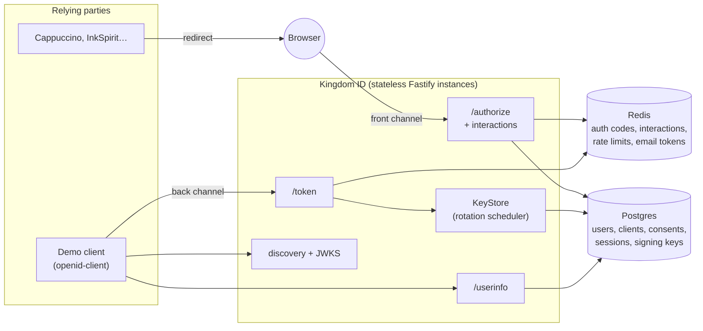

# Kingdom ID

**Kingdom ID, by Kingdom Web Builders.** One account for every Kingdom app, served by an OpenID Connect provider written from the specs.

Apps like Cappuccino and InkSpirit add "Sign in with Kingdom" the same way they'd add any OIDC provider. Users get one account across all of them, with privacy built in:

- **Private by default with third parties, unified across Kingdom apps.** Third-party apps each see their own pairwise `sub`, so they can't link a user by ID. Kingdom's own apps share one, so perks and the dashboard follow the person. *(Built.)*
- **Passkey-first sign-in**, with a password as the fallback. *(Phase 4.)*
- **A private relay email per app**, so the real address never leaves Kingdom. *(Phase 6.)*
- **One dashboard** listing every connected app, what it received, and a one-click disconnect. *(Phase 5.)*

> 🎬 _Demo GIF placeholder: sign-in from the demo app, consent, and return._

## Status

| Phase | Scope | State |
|---|---|---|
| 1 | Core provider: discovery, JWKS with rotation, code flow with PKCE, ID tokens, userinfo, consent, signup and login, demo client | ✅ Done |
| 2 | Refresh tokens with rotation and reuse detection, revocation, introspection, logout | ✅ Done |
| 3 | OpenID Foundation conformance suite in CI | Planned |
| 4 | Passkeys and the designed sign-in experience | Planned |
| 5 | "Your Kingdom" dashboard | Planned |
| 6 | Email relay via AWS SES | Planned |
| 7 | Security event pipeline (Redis Streams) | Planned |
| 8 | `kingdom` CLI, horizontal scaling proof, k6 benchmarks | Planned |
| 9 | Deployment and the Next.js integration guide | Planned |

## Architecture



The API keeps nothing in process memory that matters. Anything durable lives in Postgres and anything short-lived in Redis, so any instance can serve any request. Phase 8 demonstrates this with two instances behind a proxy.

## Quick start

Requires Node 24, pnpm (`corepack enable`) and Docker.

```bash
cp .env.example .env      # then fill KEY_ENCRYPTION_KEY and SERVER_SECRET with: openssl rand -base64 32
docker compose up -d      # Postgres on :54320, Redis on :63790
pnpm install
pnpm seed                 # registers the demo client; copy the printed secret into .env as DEMO_CLIENT_SECRET
pnpm dev                  # Kingdom ID on :4000, demo client on :4001
```

Open http://localhost:4001 and click **Sign in with Kingdom**.

## Tests

```bash
pnpm test        # unit + integration (Testcontainers starts real Postgres and Redis)
pnpm test:e2e    # Playwright through the demo client, with axe-core WCAG 2.1 AA checks
```

- **Unit tests** cover PKCE (including the RFC 7636 Appendix B vector), authorization request validation, redirect URI rules, key encryption and config.
- **Integration tests** run the real app against real Postgres and Redis: the full flow, key rotation (including five instances rotating at once), refresh token rotation and reuse detection (including concurrent exchanges), code replay, revocation, introspection, logout, token endpoint attacks, CSRF, cookies, rate limits and headers.
- **An interop test** drives everything with [`openid-client`](https://github.com/panva/openid-client), an independent certified relying-party library: discovery, authorization, token exchange, userinfo, refresh, introspection, revocation and RP-initiated logout. This shows the provider is interoperable, not just consistent with itself.

CI runs lint, typecheck, build, the test suite and the browser e2e on every push.

## Standards implemented

| Feature | Specification |
|---|---|
| Authorization code grant | RFC 6749 §4.1 |
| Refresh tokens with rotation and reuse detection | RFC 6749 §6; RFC 9700 §4.14.2 |
| Token revocation | RFC 7009 |
| Token introspection | RFC 7662 |
| RP-initiated logout | OpenID Connect RP-Initiated Logout 1.0 |
| `offline_access` | OpenID Connect Core 1.0 §11 |
| PKCE, S256 only, required for every client | RFC 7636; RFC 9700 §2.1.1 |
| ID tokens, UserInfo, `prompt`, `max_age`, `id_token_hint`, `nonce`, `at_hash` | OpenID Connect Core 1.0 |
| Pairwise subject identifiers | OpenID Connect Core 1.0 §8.1 |
| Discovery | OpenID Connect Discovery 1.0; RFC 8414 |
| JWKS | RFC 7517 (JWK), RFC 7638 (thumbprint `kid`s) |
| JWT access tokens (`typ: at+jwt`) | RFC 9068 |
| Bearer token usage at UserInfo | RFC 6750 |
| Authorization response `iss` parameter | RFC 9207 |
| `prompt=create` | OpenID Connect Initiating User Registration 1.0 |
| Security best current practice | RFC 9700 (OAuth 2.0 Security BCP) |

Planned: WebAuthn Level 3 (phase 4).

## Conformance

_Phase 3 adds the OpenID Foundation conformance suite (Basic OP profile) to CI. Results will be recorded here._

## Benchmarks

_Phase 8 adds a k6 load test of the token endpoint across two instances. Results will be recorded here._

## Threat model

| Threat | Mitigation |
|---|---|
| Authorization code interception or injection | PKCE is mandatory, S256 only. Codes are single-use (atomic `GETDEL`), expire after 60 seconds, and are bound to the client and redirect URI. Redeeming a code twice revokes every token the first redemption produced. |
| Refresh token theft | Rotation on every use. Presenting a spent token revokes the whole family (the grant, its refresh tokens and every access token minted from it). Tokens are bound to their client, expire after 30 idle days, and no family outlives 90 days. Only hashes are stored, and the `krt_` prefix lets secret scanners spot leaked tokens. |
| Revoked access tokens still accepted | JWT access tokens carry their grant ID (`gid`). UserInfo and introspection check the grant is live and the token's `jti` isn't on the Redis revocation list, so revocation, reuse detection, logout and code replay take effect immediately, not at expiry. |
| Token probing via revocation or introspection | Revocation answers 200 for unknown and foreign tokens. Introspection requires a confidential client and reports other clients' tokens as inactive. |
| Forced logout via a crafted link | RP-initiated logout asks for confirmation unless the app's `id_token_hint` names the current session (matching `sid`). Post-logout redirects require an exact match against registered URIs. |
| Open redirect or code leakage via `redirect_uri` | Exact string matching against registered URIs. Errors are never redirected until the client and redirect URI are verified. Registered URIs must be https (http only for loopback) with no fragments. `Referrer-Policy: no-referrer`. |
| IdP mix-up | The `iss` response parameter (RFC 9207), advertised in discovery. |
| CSRF on login, signup and consent | Signed double-submit tokens (HMAC of a per-browser `__Host-` cookie), a Fetch Metadata check, and `SameSite=Lax` cookies. |
| Login CSRF or hijacking an interaction | Each interaction is bound to the browser that started it, and completes exactly once. |
| Session fixation | A new session ID on every sign-in; the previous session is revoked. |
| Session theft from the database | Only SHA-256 hashes of session tokens and client secrets are stored. |
| Credential stuffing and brute force | Sliding-window limits per IP and per account at login, per IP at authorize, signup and userinfo, and per IP and per client at the token endpoint. |
| Account enumeration | Login errors and timing are uniform (argon2 runs against a dummy hash for unknown accounts). Signup does reveal that an email is taken; this is bounded by rate limits, and fully avoiding it requires email-first verification. |
| Password database compromise | argon2id with OWASP baseline parameters (19 MiB, t=2, p=1). |
| Signing key compromise or exposure | Private keys are AES-256-GCM encrypted at rest, with the `kid` bound as additional authenticated data. Keys rotate every 30 days. A new key is published as `next` a full interval before it signs, and the old one stays published while its tokens can still be valid. |
| Cross-app user correlation | Pairwise `sub` and per-client `sid`. |
| Clickjacking, XSS | `frame-ancestors 'none'`, a nonce-based CSP with `default-src 'none'`, auto-escaping server-rendered views, and no inline styles or scripts. |
| Token confusion | UserInfo accepts only `typ: at+jwt` tokens with the right issuer and audience, so an ID token can't be used as an access token. |

## Design decisions

**Hand-written protocol layer.** OAuth and OIDC logic (request validation, the interaction state machine, code handling, token issuance) is written directly from the RFCs. Only vetted primitives are libraries: `jose` for JWS/JWK, `@node-rs/argon2`, and later SimpleWebAuthn.

**Fastify, not Next.js or Express.** An identity provider is mostly protocol endpoints where the details matter: exact status codes, `Cache-Control: no-store`, form-encoded bodies, `WWW-Authenticate` challenges. Fastify keeps those explicit, has well-defined hooks for CSRF, rate limits and headers, and is fast.

**Server-rendered pages, no SPA.** The sign-in pages are Preact components rendered to HTML on the server. That allows a strict CSP and auto-escaping, with no client bundle to audit. JavaScript arrives only where WebAuthn needs it (phase 4).

**Drizzle on postgres.js.** Typed queries that stay close to SQL, and migrations committed as reviewable SQL. Invariants like "one active key per algorithm" are partial unique indexes, so the database enforces them rather than relying on the rotation code being careful.

**JWT access tokens (RFC 9068).** Kingdom apps can validate access tokens locally against the JWKS. The tradeoff is revocation, so tokens are short-lived (10 minutes). UserInfo also checks that consent still exists, so disconnecting an app stops its token there immediately. Phase 2 adds introspection for callers that need a live answer.

**RS256 by default, ES256 opt-in.** OIDC requires RS256 support and it's what most relying parties expect. Clients can register ES256 for smaller, faster ID tokens. Access tokens are always RS256, the algorithm every RFC 9068 resource server must support.

**Pairwise subjects by default.** Paired with relay emails, this means an app learns nothing that identifies the user to any other app. The sector is the redirect host, so all of a client's redirect URIs must share one host.

**Client secrets hashed with SHA-256, not argon2.** Kingdom ID generates every client secret with 256 bits of entropy, so a slow hash adds no security and would let anyone burn CPU on the token endpoint. Human-chosen passwords use argon2id.

**Rotation without coordination.** Every instance runs the rotation check, and a Postgres advisory lock lets exactly one act. Instances cache keys for 30 seconds, which is safe because a key is published long before it signs and stays published after.

**Grants as the unit of revocation.** Each code exchange creates a grant row. Its refresh tokens are the "family", and every access token carries its ID. Revoking one row (reuse, replay, client revocation, logout, or a user disconnecting an app in phase 5) invalidates everything derived from it, with no denylist to keep in sync.

**Strict reuse detection, no grace window.** Some providers tolerate a reused refresh token for a few seconds to absorb client retries. Kingdom ID doesn't: two concurrent exchanges of one token revoke the family, and the client must sign the user in again. That is safer, and a well-behaved client never sends the same refresh token twice.

**Offline grants survive logout.** Signing out ends the browser session and its online grants immediately. Grants with `offline_access` are the ones a user explicitly let outlive their session, so they continue until revoked or disconnected, as OIDC Core §11 intends.

**First-party apps share a subject.** Kingdom's own apps are registered as first-party and share one pairwise sector, so Cappuccino and InkSpirit see the same `sub` for the same person. Every other app gets its own sector, so third parties still can't correlate users.

**Authorization codes and interactions in Redis.** They're short-lived, written once and read once. `GETDEL` makes single use atomic across instances without a database round trip.

## Repository layout

```
apps/idp           Kingdom ID provider (Fastify)
apps/demo-client   Minimal relying party built on openid-client
packages/db        Drizzle schema and SQL migrations
packages/brand     Kingdom Web Builders design tokens and logos
e2e                Playwright browser tests
```

---

Kingdom ID, by [Kingdom Web Builders](https://kingdomwebbuilders.com).
