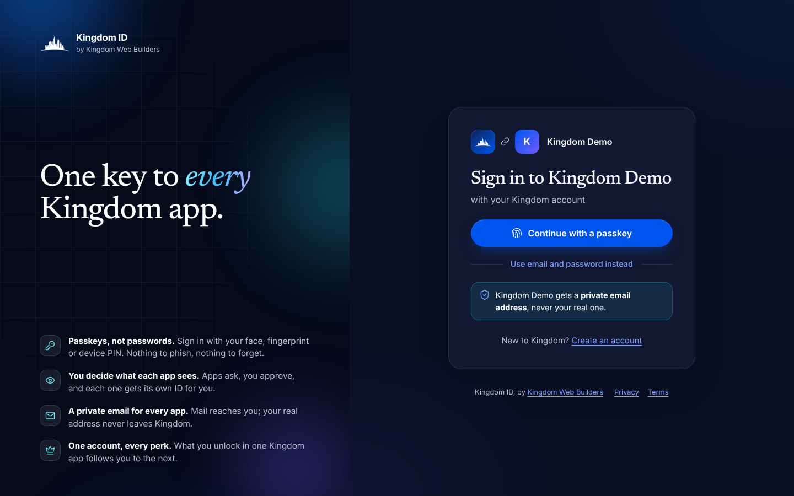
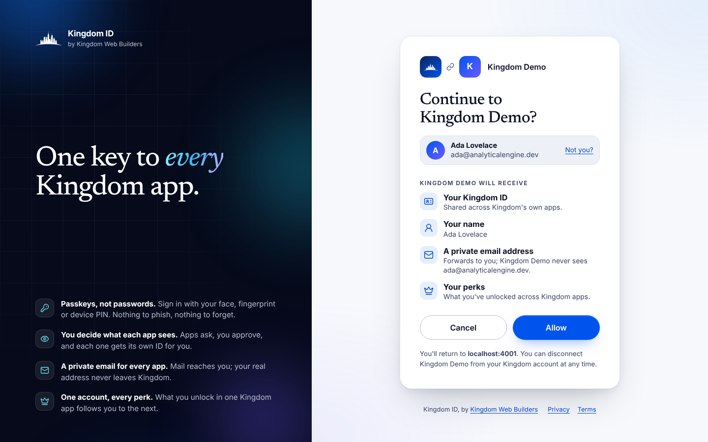
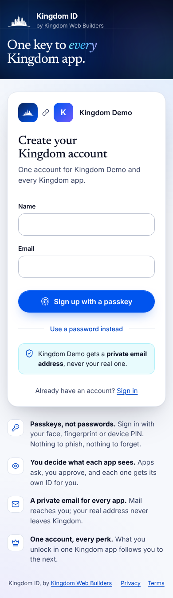
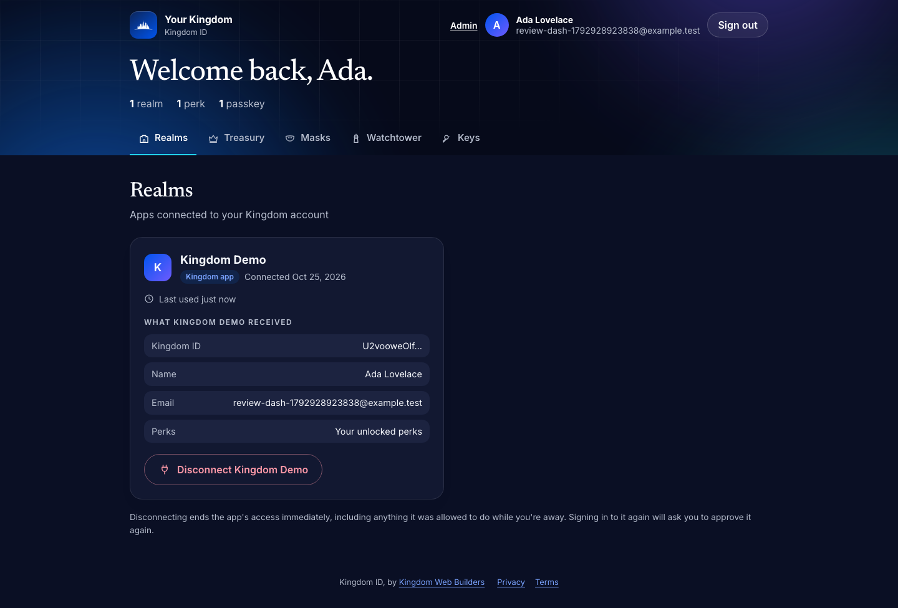
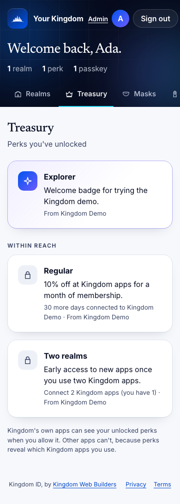
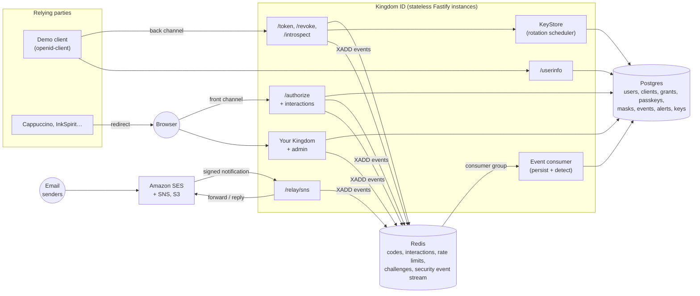

# Kingdom ID

**Kingdom ID, by Kingdom Web Builders.** One account for every Kingdom app, served by an OpenID Connect provider written from the specs.

Apps like Cappuccino and InkSpirit add "Sign in with Kingdom" the same way they'd add any OIDC provider. Users get one account across all of them, with privacy built in:

- **Private by default with third parties, unified across Kingdom apps.** Third-party apps each see their own pairwise `sub`, so they can't link a user by ID. Kingdom's own apps share one, so perks and the dashboard follow the person. *(Built.)*
- **Passkey-first sign-in**, with a password as the fallback. *(Built.)*
- **A private relay email per app**, so the real address never leaves Kingdom. Replies go back out through the relay too. *(Built; see [docs/email-relay.md](docs/email-relay.md).)*
- **"Your Kingdom", one dashboard** for every connected app, what each one received, perks that carry across apps, and a security timeline. One click disconnects an app. *(Built.)*

<p align="center">
  
</p>
<p align="center">
  
  &nbsp;
  
</p>

> 🎬 _Demo GIF placeholder: sign-in from the demo app, consent, and return._

## Status

| Phase | Scope | State |
|---|---|---|
| 1 | Core provider: discovery, JWKS with rotation, code flow with PKCE, ID tokens, userinfo, consent, signup and login, demo client | ✅ Done |
| 2 | Refresh tokens with rotation and reuse detection, revocation, introspection, logout | ✅ Done |
| 3 | OpenID Foundation conformance suite in CI | ✅ Done |
| 4 | Passkeys and the designed sign-in experience | ✅ Done |
| 5 | "Your Kingdom" dashboard | ✅ Done |
| 6 | Email relay via AWS SES | ✅ Done |
| 7 | Security event pipeline (Redis Streams) | ✅ Done |
| 8 | `kingdom` CLI, horizontal scaling proof, k6 benchmarks | Planned |
| 9 | Deployment and the Next.js integration guide | Planned |

## Your Kingdom

<p align="center">
  
</p>
<p align="center">
  
</p>

| Section | What it does |
|---|---|
| **Realms** | Every connected app, the exact claims it received (the ID it knows you by, name, email, perks, offline access), when it was connected and last used. **Disconnect** removes the consent and revokes every grant for that app, so its refresh token families and live access tokens stop working immediately. |
| **Treasury** | Perks you've unlocked, plus the ones within reach and what's left to unlock them. Apps offer perks; the rules are *connected*, *connected for N days*, *connected N Kingdom apps*, or *granted by hand*. First-party apps receive unlocked perks as the `perks` claim. |
| **Masks** | Each app's private email address, with how much mail it has forwarded and blocked. **Pause** drops new mail until resumed; **Delete** retires the address for good, and the app gets a fresh one next time. |
| **Watchtower** | A timeline of sign-ins (and failed attempts against your account), new passkeys, connected and disconnected apps, and alerts when Kingdom ID blocks a copied refresh token or a replayed sign-in. |
| **Keys** | Passkeys (add, remove, see when each was last used) and whether a password is set. |

**Admin** (`/admin`) manages each app's perks: create, pause, delete, and grant manual perks. It needs an account flagged as admin from the command line (`pnpm --filter @kingdom-id/idp make-admin you@example.com`) *and* a session signed in with a passkey.

## Security event pipeline

Every security-relevant action (sign-ins and failures, new passkeys, connected and disconnected apps, token reuse, relay spoofing) is published to a **Redis Stream** at the moment it happens. The request never waits on Postgres or on detection. Every API instance also runs a consumer in one **consumer group**, so each event is handled by exactly one instance. That instance persists it and runs the detection rules.

| Rule | Fires when | Severity | Seen by |
|---|---|---|---|
| Failed sign-in burst | 5 failed sign-ins on one account within 10 minutes | high | the member (Watchtower) and admins |
| Credential stuffing | 20 failed sign-ins from one IP within 10 minutes, across any accounts | critical | admins |
| Refresh token reuse | a spent refresh token is presented again (its family was revoked) | critical | the member and admins |
| Authorization code replay | a code is redeemed twice (its tokens were revoked) | high | the member and admins |
| Relay spoofing | mail impersonating a member tries to leave through their private address | medium | the member and admins |
| New country | a sign-in from a country this account hasn't signed in from in 180 days (needs a trusted CDN country header) | medium | the member and admins |
| New network | a sign-in from a network (/24 IPv4, /48 IPv6) this account hasn't used in 180 days | low | the member and admins |

Each alert is raised once per rule and subject per window, so a burst produces one alert, not fifty. Admins see open alerts, acknowledge them, and watch pipeline health (lag, in-flight, dead letters) at `/admin/alerts`.

**Delivery guarantees.** At-least-once: events persist by ID, so a redelivery is harmless. An entry a crashed consumer read but never acknowledged is reclaimed by another instance after 30 seconds (`XAUTOCLAIM`). An event that fails five times is moved to a dead-letter stream, so a poison event can't stall the pipeline. Approximate trimming (`MAXLEN ~`) bounds the stream, because Postgres is the record and the stream is a buffer.

## Architecture



The API keeps nothing in process memory that matters. Anything durable lives in Postgres and anything short-lived in Redis, so any instance can serve any request. Phase 8 demonstrates this with two instances behind a proxy.

## Quick start

Requires Node 24, pnpm (`corepack enable`) and Docker.

```bash
cp .env.example .env      # then fill KEY_ENCRYPTION_KEY and SERVER_SECRET with: openssl rand -base64 32
docker compose up -d      # Postgres on :54320, Redis on :63790
pnpm install
pnpm seed                 # registers the demo client; copy the printed secret into .env as DEMO_CLIENT_SECRET
pnpm dev                  # Kingdom ID on :4000, demo client on :4001
pnpm --filter @kingdom-id/idp relay:simulate <private-address>   # push a test email through the relay, no AWS needed
```

Open http://localhost:4001 and click **Sign in with Kingdom**.

## Tests

```bash
pnpm test        # unit + integration (Testcontainers starts real Postgres and Redis)
pnpm test:e2e    # Playwright through the demo client: passkeys via a virtual authenticator, axe-core WCAG 2.1 AA checks
```

- **Unit tests** cover PKCE (including the RFC 7636 Appendix B vector), authorization request validation, redirect URI rules, key encryption and config.
- **Integration tests** run the real app against real Postgres and Redis: the full flow, key rotation (including five instances rotating at once), refresh token rotation and reuse detection (including concurrent exchanges), code replay, revocation, introspection, logout, token endpoint attacks, CSRF, cookies, rate limits and headers.
- **Passkey tests** use a software authenticator that produces real WebAuthn attestations and assertions, so the server's verification runs unmodified: single-use and browser-bound challenges, wrong-origin (phishing) assertions, mismatched user handles, counter rollback, and required user verification.
- **Browser e2e tests** sign up and back in with a passkey through Chromium's virtual authenticator, check every page against WCAG 2.1 AA in dark and light mode at desktop and phone widths, check there's no horizontal scroll on phones, confirm `prefers-reduced-motion` stops the animation, and confirm the password path works with JavaScript disabled.
- **Dashboard tests** check that disconnecting an app really kills its refresh families and access tokens while other apps keep working, every perk rule (including backdated consents), that third-party apps can't obtain the `perks` scope, that each user sees only their own Watchtower, and that admin is closed to non-admins and to admins without a passkey session.
- **Pipeline tests** check that publishing doesn't write until the consumer runs, that redelivery persists once, that three consumers split thirty events with none handled twice, that a crashed consumer's unacknowledged entries are reclaimed, that a poison event is dead-lettered while later events still flow, and every detection rule including de-duplication and the trusted-proxy rule for country headers.
- **An interop test** drives everything with [`openid-client`](https://github.com/panva/openid-client), an independent certified relying-party library: discovery, authorization, token exchange, userinfo, refresh, introspection, revocation and RP-initiated logout. This shows the provider is interoperable, not just consistent with itself.

CI runs lint, typecheck, build, the test suite and the browser e2e on every push.

## Standards implemented

| Feature | Specification |
|---|---|
| Authorization code grant | RFC 6749 §4.1 |
| Refresh tokens with rotation and reuse detection | RFC 6749 §6; RFC 9700 §4.14.2 |
| Token revocation | RFC 7009 |
| Token introspection | RFC 7662 |
| RP-initiated logout | OpenID Connect RP-Initiated Logout 1.0 |
| `offline_access` | OpenID Connect Core 1.0 §11 |
| PKCE, S256 only, required for every client | RFC 7636; RFC 9700 §2.1.1 |
| ID tokens, UserInfo, `prompt`, `max_age`, `id_token_hint`, `nonce`, `at_hash` | OpenID Connect Core 1.0 |
| Pairwise subject identifiers | OpenID Connect Core 1.0 §8.1 |
| Discovery | OpenID Connect Discovery 1.0; RFC 8414 |
| JWKS | RFC 7517 (JWK), RFC 7638 (thumbprint `kid`s) |
| JWT access tokens (`typ: at+jwt`) | RFC 9068 |
| Bearer token usage at UserInfo | RFC 6750 |
| Email relay: header rewriting, encoded display names, sender authentication | RFC 5322, RFC 2047, SPF (RFC 7208), DKIM (RFC 6376), DMARC (RFC 7489) |
| Inbound delivery from SES | Amazon SNS message signatures (versions 1 and 2) |
| Authorization response `iss` parameter | RFC 9207 |
| `prompt=create` | OpenID Connect Initiating User Registration 1.0 |
| Passkeys: discoverable credentials, user verification, conditional mediation (autofill) | W3C Web Authentication Level 3 |
| `amr` values (`pwd`, `hwk`, `swk`, `user`, `mfa`) | RFC 8176 |
| `acr` `phr` (phishing-resistant) and step-up via `acr_values` | OpenID EAP ACR Values 1.0; OpenID Connect Core 1.0 §3.1.2.1 |
| Security best current practice | RFC 9700 (OAuth 2.0 Security BCP) |


## Conformance

Every CI run builds Kingdom ID from the production `Dockerfile`, puts it behind TLS, and runs the
[OpenID Foundation conformance suite](https://gitlab.com/openid/conformance-suite)'s **Basic OP certification plan**
(`release-v5.3.3`, discovery + static clients) against it. The suite's scripted browser signs in through the real login
and consent pages. Details and the full reasoning for every non-pass are in [`conformance/README.md`](conformance/README.md).

**Latest result** ([CI run 40189242195](https://github.com/jwag789/kingdom-id/actions/runs/40189242195)): 35 test modules, 1,758 conditions checked, **0 failures**.

| Result | Modules |
|---|---|
| ✅ Passed (25) | `oidcc-server`, `oidcc-server-client-secret-post`, `oidcc-response-type-missing`, `oidcc-userinfo-get`, `oidcc-userinfo-post-header`, `oidcc-userinfo-post-body`, `oidcc-ensure-request-without-nonce-succeeds-for-code-flow`, `oidcc-scope-email`, `oidcc-alternate-happy-flow`, `oidcc-display-page`, `oidcc-display-popup`, `oidcc-prompt-none-not-logged-in`, `oidcc-prompt-none-logged-in`, `oidcc-max-age-10000`, `oidcc-ensure-request-with-unknown-parameter-succeeds`, `oidcc-id-token-hint`, `oidcc-login-hint`, `oidcc-ui-locales`, `oidcc-claims-locales`, `oidcc-ensure-request-with-acr-values-succeeds`, `oidcc-codereuse`, `oidcc-codereuse-30seconds`, `oidcc-ensure-post-request-succeeds`, `oidcc-refresh-token`, `oidcc-ensure-request-with-valid-pkce-succeeds` |
| 👀 Review (4) | `oidcc-prompt-login`, `oidcc-max-age-1`, `oidcc-ensure-registered-redirect-uri`, `oidcc-ensure-request-object-with-redirect-uri`: these finish with a screenshot for a human to check (a fresh sign-in page or an error page instead of a redirect). The screenshots are in the CI artifacts. |
| ⚠️ Warning (2) | `oidcc-scope-profile` (only `name` and `updated_at` exist), `oidcc-claims-essential` (the `claims` parameter isn't supported, as discovery declares) |
| ⏭️ Skipped (4) | `oidcc-scope-address`, `oidcc-scope-phone`, `oidcc-scope-all` (scopes not offered), `oidcc-unsigned-request-object-…` (request objects not supported) |

One deliberate deviation makes the run possible: the Basic OP modules don't send PKCE, so the suite's static clients are
registered with Kingdom ID's per-client PKCE waiver. Every other client requires PKCE, and the waiver is never a default.
This is not an official OpenID certification, which requires submitting results to the OpenID Foundation.

## Benchmarks

_Phase 8 adds a k6 load test of the token endpoint across two instances. Results will be recorded here._

## Threat model

| Threat | Mitigation |
|---|---|
| Authorization code interception or injection | PKCE is mandatory, S256 only (a per-client waiver exists for the conformance suite's static clients; a `code_verifier` without a prior challenge is always rejected, blocking PKCE downgrade). Codes are single-use (atomic `GETDEL`), expire after 60 seconds, and are bound to the client and redirect URI. Redeeming a code twice revokes every token the first redemption produced. |
| Refresh token theft | Rotation on every use. Presenting a spent token revokes the whole family (the grant, its refresh tokens and every access token minted from it). Tokens are bound to their client, expire after 30 idle days, and no family outlives 90 days. Only hashes are stored, and the `krt_` prefix lets secret scanners spot leaked tokens. |
| Revoked access tokens still accepted | JWT access tokens carry their grant ID (`gid`). UserInfo and introspection check the grant is live and the token's `jti` isn't on the Redis revocation list, so revocation, reuse detection, logout and code replay take effect immediately, not at expiry. |
| Token probing via revocation or introspection | Revocation answers 200 for unknown and foreign tokens. Introspection requires a confidential client and reports other clients' tokens as inactive. |
| Forced logout via a crafted link | RP-initiated logout asks for confirmation unless the app's `id_token_hint` names the current session (matching `sid`). Post-logout redirects require an exact match against registered URIs. |
| Open redirect or code leakage via `redirect_uri` | Exact string matching against registered URIs. Errors are never redirected until the client and redirect URI are verified. Registered URIs must be https (http only for loopback) with no fragments. `Referrer-Policy: no-referrer`. |
| IdP mix-up | The `iss` response parameter (RFC 9207), advertised in discovery. |
| CSRF on login, signup and consent | Signed double-submit tokens (HMAC of a per-browser `__Host-` cookie), a Fetch Metadata check, and `SameSite=Lax` cookies. |
| Login CSRF or hijacking an interaction | Each interaction is bound to the browser that started it, and completes exactly once. |
| Session fixation | A new session ID on every sign-in; the previous session is revoked. |
| Session theft from the database | Only SHA-256 hashes of session tokens and client secrets are stored. |
| Phishing | Passkeys are bound to Kingdom ID's origin by the browser, so a look-alike site can't obtain a usable assertion (tested). Apps can demand this with `acr_values=phr`, which steps a password session up to a passkey. |
| WebAuthn replay or cross-browser relay | Challenges are random, single-use (`GETDEL`), expire in five minutes, and are bound to the browser that requested them. The returned user handle must match the credential's owner, and a signature counter that goes backwards is rejected. |
| Admin takeover | Admin is a database flag set only from the command line, and every admin page also requires a passkey session (`acr` = `phr`), so a phished password can't reach it. Admin actions are written to the audit log. |
| Cross-app linkage through perks | Perks reveal which Kingdom apps someone uses, so the `perks` scope is offered only to first-party apps by default; third parties never receive it. |
| An app keeps access after being disconnected | Disconnect removes the consent first, then revokes every grant for the app, which kills refresh token families and access tokens (checked via `gid`). UserInfo also requires the consent to exist. |
| The relay used as an open relay or to spoof a member | Only an address's owner can send through it, and only with mail that passes SPF or DKIM without failing DMARC. Spoof attempts are dropped and shown in Watchtower. Unknown and deleted addresses and relay loops are dropped. |
| Forged inbound mail notifications | `/relay/sns` accepts only messages for the configured topic with a valid SNS signature, verified against a certificate fetched over HTTPS from an Amazon SNS host. Subscription confirmation follows only SNS-hosted URLs. Redelivered notifications are processed once. |
| Real address leaking through relayed mail | Replies leave from the private address with `To`/`Cc`/`Bcc` and identifying headers rebuilt, and `mailto:` unsubscribe links are stripped. Forwarding waits until the member's own address is verified. |
| Credential stuffing and account takeover going unnoticed | Detection rules on the event stream raise alerts for failed-login bursts (per account and per IP), sign-ins from new networks or countries, refresh token reuse and code replay. Members see what concerns them in Watchtower; admins see everything. |
| Spoofed location headers | Country headers from a CDN are read only when `TRUST_PROXY` is on. Otherwise anyone could send one, so they're ignored. |
| Locking yourself out | The last passkey of a passwordless account can't be removed. |
| Credential stuffing and brute force | Sliding-window limits per IP and per account at login, per IP at authorize, signup and userinfo, and per IP and per client at the token endpoint. |
| Account enumeration | Login errors and timing are uniform (argon2 runs against a dummy hash for unknown accounts). Signup does reveal that an email is taken; this is bounded by rate limits, and fully avoiding it requires email-first verification. |
| Password database compromise | argon2id with OWASP baseline parameters (19 MiB, t=2, p=1). |
| Signing key compromise or exposure | Private keys are AES-256-GCM encrypted at rest, with the `kid` bound as additional authenticated data. Keys rotate every 30 days. A new key is published as `next` a full interval before it signs, and the old one stays published while its tokens can still be valid. |
| Cross-app user correlation | Pairwise `sub` and per-client `sid`. |
| Clickjacking, XSS | `frame-ancestors 'none'`, a nonce-based CSP with `default-src 'none'`, auto-escaping server-rendered views, and no inline styles or scripts. |
| Token confusion | UserInfo accepts only `typ: at+jwt` tokens with the right issuer and audience, so an ID token can't be used as an access token. |

## Design decisions

**ID tokens carry no personal data by default.** In the code flow, profile and email claims are released through UserInfo
against the access token (OIDC Core §5.4). ID tokens get passed around as proof of authentication, so they hold only
`sub`, `auth_time`, `amr`, `sid` and the like. The conformance suite flags the alternative as a data-exposure risk.

**Hand-written protocol layer.** OAuth and OIDC logic (request validation, the interaction state machine, code handling, token issuance) is written directly from the RFCs. Only vetted primitives are libraries: `jose` for JWS/JWK, `@node-rs/argon2`, and later SimpleWebAuthn.

**Fastify, not Next.js or Express.** An identity provider is mostly protocol endpoints where the details matter: exact status codes, `Cache-Control: no-store`, form-encoded bodies, `WWW-Authenticate` challenges. Fastify keeps those explicit, has well-defined hooks for CSRF, rate limits and headers, and is fast.

**Server-rendered pages, no SPA.** The sign-in pages are Preact components rendered to HTML on the server. That allows a strict CSP and auto-escaping, with no client bundle to audit. The only script is `passkey.js`: about 200 lines of plain JavaScript, no dependencies and no build step, loaded with a CSP nonce.

**Passkeys as progressive enhancement.** Every page works without JavaScript: the email and password forms render open. When the browser supports WebAuthn, `passkey.js` reveals the passkey button, folds the password form behind "Use email instead", and offers passkeys in the email field's autofill (conditional mediation). Passkeys are discoverable credentials with user verification required, so signing in needs no username and counts as multi-factor (`amr: [hwk|swk, user, mfa]`).

**Passkey-only accounts are first class.** Signing up with a passkey creates an account with no password at all. The WebAuthn user handle is a random value rather than the internal user ID, so authenticators never hold it.

**Hand-written CSS on the Kingdom Web Builders tokens.** Five screens didn't justify a Tailwind build step in the provider's image. The palette, type (Inter, Newsreader) and motion come straight from the KWB tokens, the fonts are self-hosted so the sign-in page makes no third-party requests, and the brand panel's aurora is transform-only and switched off under `prefers-reduced-motion`.

**Perks are evaluated, not stored.** Except for hand-granted perks, nothing records that a perk was unlocked: the rules are evaluated against the user's connections each time. Pausing a perk, or a user disconnecting an app, takes effect immediately, and there's no unlock state to drift out of sync.

**Redis Streams for security events, not a queue service.** Redis is already a dependency, and streams give the three properties needed: ordered append, consumer groups that share work across instances, and a pending-entries list for crash recovery. Detection rules query the persisted events in Postgres rather than keeping their own counters, so there's one source of truth and rules can be changed without migrating state.

**"Location" without a GeoIP database.** A sign-in counts as somewhere new when it comes from a network block the account hasn't used, plus a country when a trusted CDN supplies one (CloudFront and Cloudflare both do). Network blocks are a steadier signal than single IPs and need no licensed data. Adding a GeoIP lookup later would only enrich the event at the source.

**The relay rewrites headers, never bodies.** Bodies, MIME parts and attachments pass through byte-for-byte, so nothing the sender wrote is altered or re-encoded. Headers are rebuilt so every message leaves `From` the relay domain and is DKIM-signed for it, which is what DMARC requires of a forwarder. The trade-off is quoted reply text, which the relay leaves alone (see the relay guide's known limits).

**Deleted addresses are tombstones.** A deleted private address is kept, marked deleted, so it can never be issued to someone else and start receiving the first owner's mail.

**No privacy claims ahead of the feature.** The design calls for a note that apps receive a private email mask. That note, and the matching line in the brand story, render only when `EMAIL_RELAY_ENABLED` is on (the default since the relay shipped). Turning the relay off turns the claims off with it.

**Drizzle on postgres.js.** Typed queries that stay close to SQL, and migrations committed as reviewable SQL. Invariants like "one active key per algorithm" are partial unique indexes, so the database enforces them rather than relying on the rotation code being careful.

**JWT access tokens (RFC 9068).** Kingdom apps can validate access tokens locally against the JWKS. The tradeoff is revocation, so tokens are short-lived (10 minutes). UserInfo also checks that consent still exists, so disconnecting an app stops its token there immediately. Phase 2 adds introspection for callers that need a live answer.

**RS256 by default, ES256 opt-in.** OIDC requires RS256 support and it's what most relying parties expect. Clients can register ES256 for smaller, faster ID tokens. Access tokens are always RS256, the algorithm every RFC 9068 resource server must support.

**Pairwise subjects by default.** Paired with relay emails, this means an app learns nothing that identifies the user to any other app. The sector is the redirect host, so all of a client's redirect URIs must share one host.

**Client secrets hashed with SHA-256, not argon2.** Kingdom ID generates every client secret with 256 bits of entropy, so a slow hash adds no security and would let anyone burn CPU on the token endpoint. Human-chosen passwords use argon2id.

**Rotation without coordination.** Every instance runs the rotation check, and a Postgres advisory lock lets exactly one act. Instances cache keys for 30 seconds, which is safe because a key is published long before it signs and stays published after.

**Grants as the unit of revocation.** Each code exchange creates a grant row. Its refresh tokens are the "family", and every access token carries its ID. Revoking one row (reuse, replay, client revocation, logout, or a user disconnecting an app in phase 5) invalidates everything derived from it, with no denylist to keep in sync.

**Strict reuse detection, no grace window.** Some providers tolerate a reused refresh token for a few seconds to absorb client retries. Kingdom ID doesn't: two concurrent exchanges of one token revoke the family, and the client must sign the user in again. That is safer, and a well-behaved client never sends the same refresh token twice.

**Offline grants survive logout.** Signing out ends the browser session and its online grants immediately. Grants with `offline_access` are the ones a user explicitly let outlive their session, so they continue until revoked or disconnected, as OIDC Core §11 intends.

**First-party apps share a subject.** Kingdom's own apps are registered as first-party and share one pairwise sector, so Cappuccino and InkSpirit see the same `sub` for the same person. Every other app gets its own sector, so third parties still can't correlate users.

**Authorization codes and interactions in Redis.** They're short-lived, written once and read once. `GETDEL` makes single use atomic across instances without a database round trip.

## Repository layout

```
apps/idp           Kingdom ID provider (Fastify)
apps/demo-client   Minimal relying party built on openid-client
packages/db        Drizzle schema and SQL migrations
packages/brand     Kingdom Web Builders design tokens and logos
e2e                Playwright browser tests
```

---

Kingdom ID, by [Kingdom Web Builders](https://kingdomwebbuilders.com).
