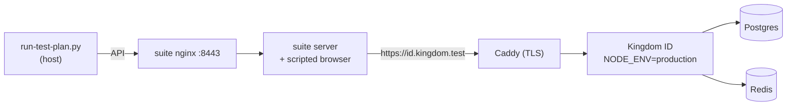

# OpenID conformance

Kingdom ID is tested against the [OpenID Foundation conformance suite](https://gitlab.com/openid/conformance-suite)'s
**Basic OP** certification plan (`oidcc-basic-certification-test-plan`, discovery + static clients), self-hosted in
Docker on every CI run.

```bash
conformance/run.sh           # build, run, tear down (about 10 minutes)
KEEP=1 conformance/run.sh    # leave it up and browse https://localhost.emobix.co.uk:8443
```

## How it works



- The suite images are the published ones, pinned to `release-v5.3.3`; `run-test-plan.py` is fetched from the same tag.
- Kingdom ID runs from the production `Dockerfile` behind TLS, with `NODE_ENV=production`.
- The suite's scripted browser signs a seeded test user in through the real login and consent pages
  (`config/basic-op.json`). Nothing is stubbed.
- `seed-conformance.ts` registers the suite's static clients and test user. All secrets in this directory are
  throwaway test values.

## Deviations from production configuration

| Setting | Why |
|---|---|
| Conformance clients have `requirePkce: false` | The Basic OP modules don't send PKCE (a separate module, `oidcc-ensure-request-with-valid-pkce-succeeds`, checks it works). Every other client requires PKCE; there is no global switch. The PKCE downgrade defense stays on for these clients. |
| `RATE_LIMIT_MULTIPLIER=50` | The suite signs one user in from one IP dozens of times a minute. |
| Conformance clients use `subject_type: public` | Matches the Basic OP profile; real clients default to pairwise. |

## Accepted results

Anything not listed in `expected-failures.json` / `expected-skips.json` fails the run.

| Module | Result | Reason |
|---|---|---|
| `oidcc-scope-address`, `oidcc-scope-phone`, `oidcc-scope-all` | skipped | Kingdom ID doesn't collect addresses or phone numbers, so it doesn't offer those scopes. |
| `oidcc-unsigned-request-object-…` | skipped | Request objects aren't supported (`request_parameter_supported: false`); the server rejects them with `request_not_supported`. |
| `oidcc-scope-profile` | warning | Only `name` and `updated_at` exist for the profile scope; the other profile claims are optional. |
| `oidcc-ensure-request-with-acr-values-succeeds` | warning | No `acr` claim is issued yet; `acr_values` is a voluntary request. Revisit with passkeys (phase 4). |
| `oidcc-claims-essential` | warning | The `claims` request parameter isn't supported, as discovery says. |
| `oidcc-prompt-login`, `oidcc-max-age-1`, `oidcc-ensure-registered-redirect-uri`, `oidcc-ensure-request-object-with-redirect-uri` | review | These need a human to look at a screenshot (a re-login page or an error page). The scripted browser captures them; they're uploaded with the CI artifacts. |
