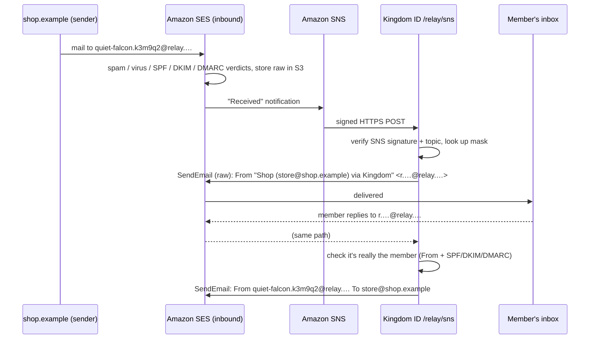

# Email relay

Every app a Kingdom member allows to see their email gets a **private address**, such as `quiet-falcon.k3m9q2@relay.kingdomwebbuilders.com`, instead of the real one. Mail to it is forwarded to the member's verified inbox. Replies go back out *from the private address*, so the app never learns the real one. Members can pause or delete any address from **Your Kingdom → Masks**.



## How addresses work

- **One address per app per member**, created when the member first allows that app to see their email, and returned as the `email` claim. `email_verified` describes the member's real address, since that's where mail is delivered.
- **Forwarding needs a verified inbox.** Until the member verifies their email, mail to their addresses is held back (dropped and counted), so an unverified typo can't turn the relay into a way to mail strangers.
- **Pause** drops new mail until resumed. **Delete** retires the address permanently: it's kept as a tombstone so it's never issued to anyone again, and the app receives a new address the next time it reads `email`.
- **Replies** go through a *reverse alias* (`r.<random>@relay…`), one per outside correspondent per address. Only the address's owner can send through it, and only with mail that passes SPF or DKIM without failing DMARC. Anything else is dropped and shown in Watchtower as "Blocked an email pretending to be you".

## What gets rewritten

Only headers are touched; the body, including MIME parts and attachments, is passed through byte-for-byte.

| Direction | Removed | Added or replaced |
|---|---|---|
| Outside → member | `DKIM-Signature`, `ARC-*`, `Authentication-Results`, `Received-SPF`, `Return-Path`, `Sender`, `From`, `Reply-To`, `X-SES-*`, `List-Unsubscribe*` | `From: "Name (sender@domain) via Kingdom" <reverse alias>`, `Reply-To: <reverse alias>`, `X-Kingdom-Relay`, `X-Kingdom-Original-From` |
| Member → outside (reply) | everything above, plus `To`, `Cc`, `Bcc`, read-receipt requests | `From: <private address>`, `To: <correspondent>` |

**Why `From` is rewritten.** Forwarding a message with the original sender's `From` would fail DMARC: Kingdom ID can't produce a valid DKIM signature for `shop.example`, and strict domains would reject or quarantine it. Every message the relay sends is `From` the relay domain and DKIM-signed for it, with the original sender kept in the display name and in `X-Kingdom-Original-From`.

**Why `List-Unsubscribe` is removed.** A `mailto:` unsubscribe would be sent from the member's real address, revealing it. Members can pause or delete the address instead.

## Setup on AWS

The examples use `relay.kingdomwebbuilders.com` and `us-east-1`; substitute your own. SES email receiving is available only in some regions.

### 1. Verify the relay domain in SES

Create an SES **domain identity** for `relay.kingdomwebbuilders.com` with **Easy DKIM** (RSA 2048). SES gives you three DKIM records.

### 2. DNS records

| Type | Name | Value | Why |
|---|---|---|---|
| `MX` | `relay.kingdomwebbuilders.com` | `10 inbound-smtp.us-east-1.amazonaws.com` | Routes mail for private addresses to SES receiving. |
| `CNAME` ×3 | `<token>._domainkey.relay.kingdomwebbuilders.com` | `<token>.dkim.amazonses.com` | Easy DKIM: SES signs everything the relay sends with `d=relay.kingdomwebbuilders.com`. |
| `MX` | `bounce.relay.kingdomwebbuilders.com` | `10 feedback-smtp.us-east-1.amazonses.com` | Custom MAIL FROM domain, so bounces come back to SES. |
| `TXT` | `bounce.relay.kingdomwebbuilders.com` | `v=spf1 include:amazonses.com -all` | **SPF**: authorizes SES to send with this envelope sender, and nothing else. |
| `TXT` | `relay.kingdomwebbuilders.com` | `v=spf1 -all` | The relay domain itself never appears as an envelope sender; say so explicitly. |
| `TXT` | `_dmarc.relay.kingdomwebbuilders.com` | `v=DMARC1; p=reject; adkim=s; aspf=r; rua=mailto:dmarc@kingdomwebbuilders.com` | **DMARC**: mail claiming to be from the relay domain must align with DKIM (strict, since SES always signs with exactly this domain) or SPF via the MAIL FROM subdomain (relaxed). Anything else is rejected, so nobody can spoof a private address. Aggregate reports go to `rua`. |

Then, in the SES identity, set the **custom MAIL FROM domain** to `bounce.relay.kingdomwebbuilders.com` with "reject message" as the behavior on MX failure.

### 3. Receive mail

1. Create an S3 bucket for raw messages, encrypted, with a lifecycle rule that expires objects after 7 days. Its bucket policy must allow `ses.amazonaws.com` to `s3:PutObject`, conditioned on your account ID.
2. Create an SNS topic (for example `kingdom-relay`).
3. Create an SES **receipt rule set** (and make it active) with one rule:
   - Recipients: `relay.kingdomwebbuilders.com`
   - Enable spam and virus scanning
   - Action 1: **S3** into the bucket, with **SNS notification** to the topic. This handles messages of any size (SES accepts up to 40 MB).
   - For a low-volume setup, a single **SNS** action with Base64 encoding also works, but caps messages at 150 KB.
4. Subscribe `https://id.kingdomwebbuilders.com/relay/sns` to the topic (protocol HTTPS). Kingdom ID confirms the subscription automatically, but only for its configured topic and only by following an SNS-hosted `SubscribeURL`.

### 4. Permissions for Kingdom ID

```json
{
  "Version": "2012-10-17",
  "Statement": [
    {
      "Effect": "Allow",
      "Action": "ses:SendRawEmail",
      "Resource": "arn:aws:ses:us-east-1:123456789012:identity/relay.kingdomwebbuilders.com"
    },
    {
      "Effect": "Allow",
      "Action": "s3:GetObject",
      "Resource": "arn:aws:s3:::kingdom-relay-inbound/*"
    }
  ]
}
```

New SES accounts start in the **sandbox**, which can only send to verified addresses. Request production access before going live.

### 5. Configure Kingdom ID

```bash
EMAIL_RELAY_ENABLED=true
RELAY_DOMAIN=relay.kingdomwebbuilders.com
RELAY_TRANSPORT=ses
AWS_REGION=us-east-1
RELAY_SNS_TOPIC_ARN=arn:aws:sns:us-east-1:123456789012:kingdom-relay
# Optional: an SES configuration set for delivery/bounce/complaint events
RELAY_SES_CONFIGURATION_SET=kingdom-relay
```

AWS credentials come from the standard chain (an instance/task role in production).

## Security properties

- **Only SNS can deliver.** `/relay/sns` exists only when `RELAY_SNS_TOPIC_ARN` is set. It accepts a message only if it names that topic and carries a valid SNS signature (versions 1 and 2), verified against a certificate fetched over HTTPS from an `sns.<region>.amazonaws.com` host.
- **At-least-once delivery is safe.** Each (SES message ID, recipient) pair is processed once (Redis, 7 days), so SNS retries never double-forward.
- **No open relay.** Unknown recipients, deleted addresses and loops (mail from the relay domain itself) are dropped. Replies must come from the owner and authenticate.
- **SES verdicts are enforced.** Virus `FAIL` drops the message. Spam `FAIL`, or DMARC `FAIL` with a `reject` policy, drops it and counts it as blocked on the address.

## Trying it locally

Without AWS, the relay uses an in-memory transport that logs instead of sending. Push a message through it by hand:

```bash
pnpm --filter @kingdom-id/idp relay:simulate quiet-falcon.k3m9q2@relay.localhost store@shop.example "Your order"
```

It prints the outcome and the exact message that would be sent, headers rewritten. Pass the reverse alias from that output as the first argument to simulate a reply. The member must have verified their email for mail to forward. In development the verification link is in the IdP's log.

## Known limits

- Quoted text in a reply (for example "On Monday, Ada \<ada@…\> wrote:") is part of the body, which the relay never rewrites. Mail clients usually quote the reverse alias rather than the real address, but this isn't guaranteed.
- Bounce and complaint handling for relayed mail uses SES's account-level suppression. Per-address bounce feedback into Watchtower would be a natural next step.
