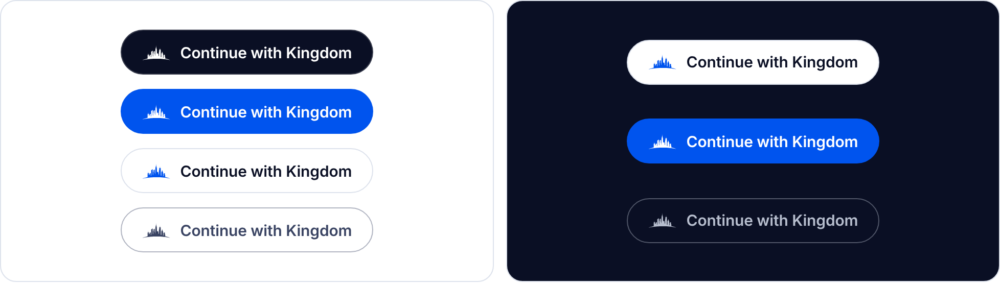

# Add "Sign in with Kingdom" to a Next.js app

This guide adds Kingdom ID sign-in to a Next.js App Router app with [Auth.js](https://authjs.dev) (`next-auth` v5), using **Cappuccino** as the example. Every snippet here comes from [`examples/cappuccino`](../../examples/cappuccino), which CI builds and drives through a real browser on every push, so the code is known to work.

Your app ends up with:

- the official **Sign in with Kingdom** button (passkey-first sign-in, handled by Kingdom ID);
- the member's name, plus a **private email address** unique to your app;
- their **Kingdom perks**, if your app is a first-party Kingdom app;
- **Sign out**, either of your app only or of Kingdom too;
- **automatic sign-out** when the member signs out of Kingdom or disconnects your app.

## 1. Register your app with Kingdom ID

An operator registers the app with the [`kingdom` CLI](../../README.md#the-kingdom-cli):

```bash
kingdom clients create --name Cappuccino --first-party \
  --redirect-uri https://cappuccino.example/api/auth/callback/kingdom \
  --post-logout-uri https://cappuccino.example/ \
  --backchannel-logout-uri https://cappuccino.example/api/kingdom/backchannel-logout
```

It prints a `client_id` and a `client_secret` **once**: store the secret now.

- `--redirect-uri` must exactly match Auth.js's callback URL: `<your origin>/api/auth/callback/kingdom`. Kingdom ID matches redirect URIs exactly, with no wildcards.
- `--first-party` is for Kingdom Web Builders' own apps. They share one user ID across apps and may request perks. Leave it off for anyone else's app; that app then gets a private ID for each member.
- `--backchannel-logout-uri` is where Kingdom ID tells your server a member's session ended (step 7). It must be `https`, except on loopback.
- For local development, register `http://localhost:<port>/…`. Plain `http` is accepted only for loopback addresses.

## 2. Install and configure

```bash
npm install next-auth@5.0.0-beta.32
```

Pin the exact version. Auth.js v5 is published as a beta, so a range could pull in unreviewed changes.

```bash
# .env.local
KINGDOM_ISSUER=https://id.kingdomwebbuilders.com
AUTH_KINGDOM_ID=kid_…            # from step 1
AUTH_KINGDOM_SECRET=…            # from step 1
AUTH_SECRET=…                    # openssl rand -base64 32
AUTH_URL=https://cappuccino.example
```

## 3. The Kingdom provider

[`auth.ts`](../../examples/cappuccino/auth.ts):

```ts
import NextAuth from "next-auth";
import type { OIDCConfig } from "next-auth/providers";
import { decodeJwt } from "jose";

export interface KingdomPerk {
  id: string;
  name: string;
  app: string;
}

interface KingdomProfile {
  sub: string;
  name?: string;
  email?: string; // a private relay address unique to your app
  email_verified?: boolean;
  perks?: KingdomPerk[];
}

export const KINGDOM_ISSUER = process.env.KINGDOM_ISSUER ?? "https://id.kingdomwebbuilders.com";

const Kingdom: OIDCConfig<KingdomProfile> = {
  id: "kingdom",
  name: "Kingdom",
  type: "oidc",
  issuer: KINGDOM_ISSUER,
  clientId: process.env.AUTH_KINGDOM_ID,
  clientSecret: process.env.AUTH_KINGDOM_SECRET,
  authorization: { params: { scope: "openid profile email perks" } },
  checks: ["pkce", "state", "nonce"],
  idToken: false,
  profile(profile) {
    return { id: profile.sub, name: profile.name ?? null, email: profile.email ?? null };
  },
};

declare module "next-auth" {
  interface Session {
    perks: KingdomPerk[];
    /** Kingdom's stable ID for this member: key your own records on this, never on email. */
    kingdomSub: string;
  }
}

export const { handlers, auth, signIn, signOut } = NextAuth({
  providers: [Kingdom],
  callbacks: {
    async jwt({ token, account, profile }) {
      if (account && profile) {
        token.perks = (profile as unknown as KingdomProfile).perks ?? [];
        token.idToken = account.id_token; // for "sign out of Kingdom too"; never sent to the browser
        token.kingdomSub = account.providerAccountId; // Kingdom's sub; Auth.js's own token.sub is random
        token.sid = account.id_token ? decodeJwt(account.id_token).sid : undefined;
        token.signedInAt = Math.floor(Date.now() / 1000);
      }
      // Kingdom said this session ended (step 7): end it here too. Imported lazily
      // because lib/kingdom-logout imports KINGDOM_ISSUER from this file.
      const { isLoggedOut } = await import("@/lib/kingdom-logout");
      if (isLoggedOut({ sid: token.sid, kingdomSub: token.kingdomSub, signedInAt: token.signedInAt })) return null;
      return token;
    },
    session({ session, token }) {
      session.perks = (token.perks as KingdomPerk[] | undefined) ?? [];
      session.kingdomSub = token.kingdomSub as string;
      return session;
    },
  },
});
```

Three settings are specific to Kingdom ID:

| Setting | Why |
|---|---|
| `idToken: false` | **The one people miss.** Kingdom ID keeps personal data out of ID tokens: name, email and perks come from the UserInfo endpoint, as OpenID Connect Core §5.4 describes for the code flow. With `idToken: false`, Auth.js still validates the ID token, then fetches UserInfo for the profile. Without it, your users would have no name or email. |
| `checks: ["pkce", "state", "nonce"]` | Kingdom ID rejects any authorization request without PKCE (S256). State and nonce add CSRF and replay protection. |
| `scope` | `openid` is required. `profile` gives the name, `email` the private address, `perks` the member's unlocked perks (first-party apps only; for anyone else it's silently dropped). Add `offline_access` only if your server calls Kingdom APIs while the member is away. |

Then the route handler, [`app/api/auth/[...nextauth]/route.ts`](../../examples/cappuccino/app/api/auth/[...nextauth]/route.ts):

```ts
import { handlers } from "@/auth";

export const { GET, POST } = handlers;
```

## 4. The button

<p align="center">
  
</p>

Use the official **Sign in with Kingdom** button, so members recognize it in every app. Kingdom ID serves it as one small stylesheet, with no script and no images. Pick a look, size and label at **`<issuer>/brand`**, the button builder, which also lists the usage rules.

Link the stylesheet once, in [`app/layout.tsx`](../../examples/cappuccino/app/layout.tsx):

```tsx
<head>
  <link rel="stylesheet" href={`${KINGDOM_ISSUER}/brand/button.css`} />
</head>
```

To serve it yourself instead, download `button.css` from the builder and import it like any other stylesheet.

[`components/sign-in-with-kingdom.tsx`](../../examples/cappuccino/components/sign-in-with-kingdom.tsx) is a server-action form, so it works without client JavaScript:

```tsx
import { signInWithKingdom } from "@/app/actions";

export function SignInWithKingdom() {
  return (
    <form action={signInWithKingdom}>
      <button type="submit" className="kingdom-button">
        Sign in with Kingdom
      </button>
    </form>
  );
}
```

The `kingdom-button` class draws the button and the Kingdom mark; modifiers such as `kingdom-button--light` or `kingdom-button--lg` change the look. Your own `button` styles don't leak into it. If your app sends a Content Security Policy, allow `data:` in `img-src` (the mark is inlined) and the issuer in `style-src`.

## 5. Sign in, sign out

[`app/actions.ts`](../../examples/cappuccino/app/actions.ts):

```ts
"use server";

import { headers } from "next/headers";
import { redirect } from "next/navigation";
import { getToken } from "next-auth/jwt";
import { KINGDOM_ISSUER, signIn, signOut } from "@/auth";

export async function signInWithKingdom() {
  await signIn("kingdom", { redirectTo: "/" });
}

/** Ends your app's session only; signing back in is one click. */
export async function signOutOfCappuccino() {
  await signOut({ redirectTo: "/" });
}

/** Ends your app's session and the Kingdom session (RP-Initiated Logout). */
export async function signOutEverywhere() {
  const appUrl = process.env.AUTH_URL ?? "http://localhost:4002";
  const token = await getToken({
    req: { headers: await headers() },
    secret: process.env.AUTH_SECRET,
    secureCookie: appUrl.startsWith("https://"),
  });
  await signOut({ redirect: false });
  const endSession = new URL("/end-session", KINGDOM_ISSUER);
  if (typeof token?.idToken === "string") endSession.searchParams.set("id_token_hint", token.idToken);
  endSession.searchParams.set("post_logout_redirect_uri", `${appUrl}/`);
  redirect(endSession.toString());
}
```

Sending the ID token as `id_token_hint` proves which Kingdom session to end, so the member is signed out without a confirmation page. Without it, Kingdom ID asks first, so that a random link can't sign people out. The `post_logout_redirect_uri` must be one you registered with `--post-logout-uri`.

## 6. Use the session

```tsx
import { auth } from "@/auth";

export default async function Home() {
  const session = await auth();
  if (!session?.user) return <SignInWithKingdom />;
  return (
    <>
      <h1>Welcome back, {session.user.name}</h1>
      <p>We'll email you at {session.user.email}</p>
      <ul>{session.perks.map((p) => <li key={p.id}>{p.name} from {p.app}</li>)}</ul>
    </>
  );
}
```

## 7. Sign out when Kingdom says so

Disconnecting your app in the Kingdom dashboard revokes your tokens immediately, but your app's own session cookie is yours: Kingdom ID can't delete it. Instead, with **Back-Channel Logout**, Kingdom ID POSTs a signed `logout_token` to your server when the member signs out of Kingdom, disconnects your app, or when Kingdom ID detects their tokens were stolen. Your app then ends that session on its next request.

[`app/api/kingdom/backchannel-logout/route.ts`](../../examples/cappuccino/app/api/kingdom/backchannel-logout/route.ts):

```ts
import { acceptLogoutToken } from "@/lib/kingdom-logout";

export async function POST(request: Request) {
  const token = (await request.formData()).get("logout_token");
  try {
    if (typeof token !== "string") throw new Error("logout_token missing");
    await acceptLogoutToken(token);
    return new Response(null, { status: 200, headers: { "cache-control": "no-store" } });
  } catch {
    return new Response(null, { status: 400, headers: { "cache-control": "no-store" } });
  }
}
```

[`lib/kingdom-logout.ts`](../../examples/cappuccino/lib/kingdom-logout.ts) verifies the token with `jose` against Kingdom's JWKS: issuer, audience (your client ID), `typ: logout+jwt`, at most 2 minutes old, the back-channel `events` claim, no `nonce`, and a `jti` it hasn't seen. It then records either the Kingdom session ID (`sid`, sent on sign-out) or the member (`sub`, sent on disconnect, meaning every session that started before now). The `jwt` callback in step 3 checks that record on every request and returns `null`, which signs the member out.

The example keeps the record in memory, which is fine for one server process. **With more than one instance, store it somewhere they all share** (Redis, or your database), with entries expiring after your session lifetime.

Kingdom ID retries a failed delivery (any response other than 2xx, or no answer within 5 seconds) and gives up after five attempts. Respond quickly, and don't redirect.

## Things to know

**The email is private, and it's real.** `session.user.email` is an address like `quiet-falcon.k3m9q2@relay.kingdomwebbuilders.com`. Mail you send to it reaches the member, and their replies come back from it. Treat it as their email address: don't expect it to match the address they use elsewhere, and don't ask them for their "real" one. Members can pause or delete it, and if they delete it your app gets a new one at their next sign-in, so update it from the session rather than caching it forever.

**Identify members by `sub`, never by email.** Kingdom's `sub` is the stable key. In Auth.js it arrives as `account.providerAccountId` (stored as `session.kingdomSub` above); Auth.js's own `user.id` and `token.sub` are random and change at every sign-in. First-party apps share one `sub` per member, and other apps each get their own.

**Perks are evaluated live.** A perk can appear or disappear between sign-ins. Unlocks depend on what the member connects, and Kingdom can pause a perk. Read `session.perks` when deciding, and don't store it as a permanent entitlement.

**Members can disconnect your app** from their Kingdom dashboard at any time. That revokes your tokens immediately, signs them out of your app (step 7), and the next sign-in asks for consent again.

**Local development.** Point `KINGDOM_ISSUER` at a local Kingdom ID (`http://localhost:4000`) and register `http://localhost:<port>/api/auth/callback/kingdom`. Auth.js allows `http` issuers, and Kingdom ID allows `http` redirect URIs only on loopback.

## Troubleshooting

| Symptom | Cause |
|---|---|
| Kingdom shows **Unrecognized return address** | The callback URL Auth.js sent doesn't exactly match a registered redirect URI. Check the scheme, host, port and the `/api/auth/callback/kingdom` path. |
| Signed in, but `name` and `email` are empty | `idToken: false` is missing, so Auth.js read the profile from the ID token, which carries no personal claims. |
| `perks` is always empty | The app isn't registered as first-party (`--first-party`), or no perks are unlocked yet. |
| **invalid_client** in your server logs | Wrong `AUTH_KINGDOM_SECRET`, or the client was registered with `--auth-method post` (Auth.js uses `client_secret_basic`). |
| Still signed in after disconnecting the app | No `--backchannel-logout-uri` registered, the endpoint returned non-2xx (check your logs for the 400), or the `jwt` callback compares Auth.js's `token.sub` instead of `kingdomSub`. |
| Sign-out asks "Sign out of Kingdom?" | No `id_token_hint` was sent, or it was for a different session. It's still safe, just one more click. |
